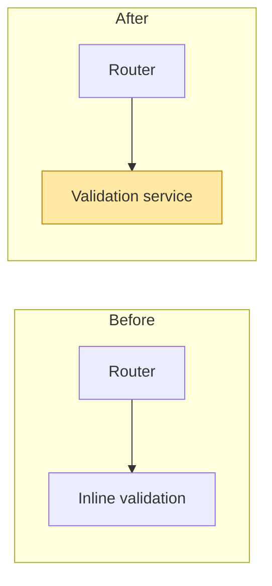
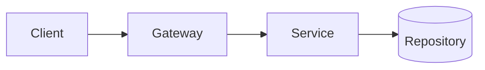
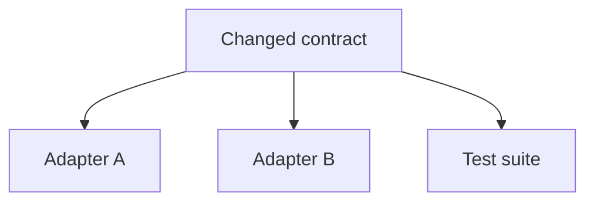
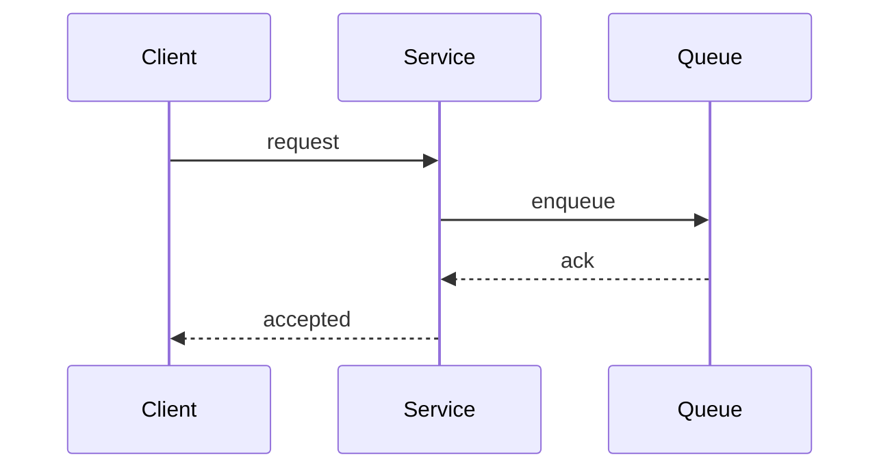

# View selection

Choose one view. A second view is a separate request, because mixing views
produces a diagram that answers nothing precisely.

## before-after

Use when the change moves an owner, a boundary, a public contract, or a data
path. Show only the parts that move; unchanged context is one node labelled
with its owner.

## call-path

Use when the sequence of components for one request changes. Start at the entry
point and stop at the durable boundary, not at every helper.

## impact

Use when the risk is who else depends on the change. Group dependents by
contract, not by directory.

## sequence

Use when ordering, retries, or failure handling across actors is the point.

## Size limits

- `max_nodes` and `max_edges` come from the project configuration.
- Prefer one view at a lower level of detail over a wide diagram.
- If the honest answer needs more nodes, split by boundary and link the parts;
  do not shrink the labels until they stop meaning anything.
